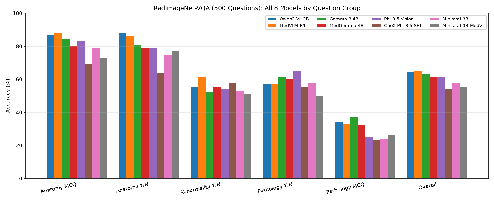

# Zero-shot VLM benchmark: BUS-BRA, RadImageNet-VQA, and BanglaMedVQA

We tested whether medical vision-language models (VLMs) perform better than their general-purpose base models on medical image tasks, without fine-tuning or examples in the prompt. As a control, we then repeated every task with the image replaced by a blank white image (and also a blank black image on BUS-BRA), to see how much each answer depends on the image (see [Blank-image control](#blank-image-control)).

We compared **four model pairs (8 models total)** across three datasets.

| Pair | General model | Medical model |
|---|---|---|
| Qwen2-VL (~2B) | `Qwen/Qwen2-VL-2B-Instruct` | `JZPeterPan/MedVLM-R1` |
| Gemma 3 (~4B) | `google/gemma-3-4b-it` | `google/medgemma-4b-it` |
| Phi-3.5-Vision (~4.2B) | `microsoft/Phi-3.5-vision-instruct` | `HaiZhiYan/CheX-Phi35V` (`CheX-Phi-3.5-vision-instruct-SFT`) |
| Ministral-3B (~3B) | `mistralai/Ministral-3-3B-Instruct-2512-BF16` | `OpenMed/Ministral-3B-MedVL` |

| Task | Dataset | What the model had to do | Sample |
|---|---|---|---|
| Classification | BUS-BRA (breast ultrasound) | Classify each lesion as benign or malignant | 400 images (200 each) |
| Visual QA | RadImageNet-VQA (CT, MRI) | Answer yes/no and multiple-choice questions | 500 questions |
| Visual QA in Bangla | BanglaMedVQA (chest X-rays and MedICaT images) | Answer open-ended questions written in Bangla | 500 questions |

## Key findings

- **BUS-BRA:** Most models collapsed toward predicting a single class or failed formatting. **MedGemma 4B** (`57.50%`) and **Ministral-3B-MedVL** (`54.25%`) were the only models above the `50%` chance baseline.
- **RadImageNet-VQA:** Overall accuracy ranged from `53.80%` to `65.00%` (chance is `40%`). None of the medical models consistently outperformed their base models overall: **MedVLM-R1** (`65.00%`) led slightly, while **MedGemma 4B** (`61.20%`), **Ministral-3B-MedVL** (`55.40%`), and **CheX-Phi-3.5-SFT** (`53.80%`) scored slightly or noticeably lower than their base models.
- **BanglaMedVQA:** Broad multimodal medical adaptation helped (**MedGemma 4B** `31.48%` LAVE, **Ministral-3B-MedVL** `29.59%` LAVE), whereas narrow English chest X-ray fine-tuning hurt (**CheX-Phi-3.5-SFT** `3.40%` LAVE vs. **Phi-3.5-Vision** `5.36%` LAVE).
- **Blank-image control:** Removing the image dropped RadImageNet-VQA accuracy by **10.40–24.20 percentage points** across all 8 models (mostly on anatomy questions) and dropped BanglaMedVQA LAVE for 7 of 8 models. On BUS-BRA, `50.00%` blank-image accuracy came from predicting a single class on a 50/50 dataset.

## Cross-benchmark standing (All 8 models)

| Pair & Model | BUS-BRA Real (White) | RadImageNet-VQA Real (White) | BanglaMedVQA Real LAVE (White) |
|---|---:|---:|---:|
| **Qwen2-VL-2B** | 50.00% (50.00%) | 64.20% (41.60%) | 15.14% (2.70%) |
| **MedVLM-R1** | 50.00% (50.00%) | **65.00%** (43.80%) | 15.98% (2.60%) |
| **Gemma 3 4B** | 50.25% (50.00%) | 63.00% (38.80%) | 24.10% (11.68%) |
| **MedGemma 4B** | **57.50%** (50.00%) | 61.20% (38.40%) | **31.48%** (7.18%) |
| **Phi-3.5-Vision** | 50.00% (50.00%) | 61.20% (40.20%) | 5.36% (4.84%) |
| **CheX-Phi-3.5-SFT** | 6.75% *(53.75% 1st-word)* (0.00%) | 53.80% (43.40%) | 3.40% (5.20%) |
| **Ministral-3B (Base)** | 31.50% (0.00%) | 57.80% (40.80%) | 22.62% (18.28%) |
| **Ministral-3B-MedVL** | **54.25%** (50.00%) | 55.40% (38.00%) | **29.59%** (14.32%) |

## Results

### BUS-BRA

*400 images (200 benign, 200 malignant); chance level = 50%.*

| Model | Real Accuracy | White Blank Accuracy | Notes |
|---|---:|---:|---|
| Qwen2-VL-2B | 50.00% | 50.00% | Answered “benign” every time |
| MedVLM-R1 | 50.00% | 50.00% | Answered “benign” every time |
| Gemma 3 4B | 50.25% | 50.00% | “Malignant” 391 times, “benign” 9 times (real) |
| **MedGemma 4B** | **57.50%** | 50.00% | 41% sensitivity (82/200), 74% specificity (148/200) |
| Phi-3.5-Vision | 50.00% | 50.00% | Collapsed to single-class prediction |
| CheX-Phi-3.5-SFT | 6.75% *(53.75% 1st-word)* | 0.00% | Verbose chest X-ray sentences instead of a single label |
| Ministral-3B (Base) | 31.50% | 0.00% | Weak formatting compliance on strict classification |
| **Ministral-3B-MedVL** | **54.25%** | 50.00% | Improved formatting and classification over base (+22.75 pp) |

### RadImageNet-VQA

*500 questions (100 in each group); overall chance level = 40%.*

- **First two pairs (Qwen2-VL / MedVLM-R1 and Gemma 3 / MedGemma):** Scored `61.20%–65.00%` on real images and dropped to `38.40%–43.80%` on blank white images. Anatomy questions showed the largest real-vs-blank gap, while pathology questions stayed close to chance.
- **Newer two pairs (Phi-3.5-Vision / CheX-Phi-3.5-SFT and Ministral-3B / Ministral-3B-MedVL):**
  - **Phi-3.5-Vision:** `61.20%` (real) → `40.20%` (white blank), −21.00 pp.
  - **CheX-Phi-3.5-SFT:** `53.80%` (real) → `43.40%` (white blank), −10.40 pp.
  - **Ministral-3B (Base):** `57.80%` (real) → `40.80%` (white blank), −17.00 pp.
  - **Ministral-3B-MedVL:** `55.40%` (real) → `38.00%` (white blank), −17.40 pp.

### BanglaMedVQA

*500 open-ended questions in Bangla, covering abnormality, condition, modality, organ, and position across ChestX-ray8 and MedICaT images.*

We scored answers using exact match (EM), normalized EM, BERTScore, and LAVE (`GPT-4.1-mini` judge). We use LAVE as the main metric.

| Model | Real EM | Real Norm EM | Real BERTScore | Real LAVE | White LAVE | $\Delta$ LAVE (Real − White) |
|---|---:|---:|---:|---:|---:|---:|
| Qwen2-VL-2B | 0.00% | 2.40% | 68.60% | 15.14% | 2.70% | +12.44 pp |
| MedVLM-R1 | 0.00% | 3.40% | 68.44% | 15.98% | 2.60% | +13.38 pp |
| Gemma 3 4B | 2.40% | 4.80% | 68.98% | 24.10% | 11.68% | +12.42 pp |
| **MedGemma 4B** | 1.60% | **12.20%** | 71.38% | **31.48%** | 7.18% | **+24.30 pp** |
| Phi-3.5-Vision | 0.00% | 0.00% | 71.22% | 5.36% | 4.84% | +0.52 pp |
| CheX-Phi-3.5-SFT | 0.00% | 0.00% | 60.83% | 3.40% | 5.20% | −1.80 pp |
| Ministral-3B (Base) | 1.80% | 1.80% | 67.42% | 22.62% | 18.28% | +4.34 pp |
| **Ministral-3B-MedVL** | **11.60%** | 11.80% | **75.08%** | 29.59% | 14.32% | +15.27 pp |

**LAVE by question type — Real (White):**

| Model | Modality | Organ | Position | Condition | Abnormality |
|---|---:|---:|---:|---:|---:|
| Qwen2-VL-2B | 55.80% (1.60%) | 3.30% (0.40%) | 2.20% (7.30%) | 8.30% (2.80%) | 6.10% (1.40%) |
| MedVLM-R1 | 56.50% (2.30%) | 5.30% (0.30%) | 3.70% (3.00%) | 8.00% (3.50%) | 6.40% (3.90%) |
| Gemma 3 4B | 60.70% (48.70%) | 47.10% (0.50%) | 6.10% (7.20%) | 6.60% (1.70%) | 0.00% (0.30%) |
| **MedGemma 4B** | **73.30%** (7.30%) | **63.10%** (21.40%) | 4.90% (4.00%) | **11.10%** (2.20%) | 5.00% (1.00%) |
| Phi-3.5-Vision | 18.55% (15.70%) | 3.80% (5.60%) | 2.55% (2.30%) | 1.30% (0.60%) | 0.60% (0.00%) |
| CheX-Phi-3.5-SFT | 6.90% (15.20%) | 2.30% (0.00%) | 2.00% (3.30%) | 4.90% (7.50%) | 0.90% (0.00%) |
| Ministral-3B (Base) | 53.20% (49.40%) | 44.60% (0.00%) | **6.70%** (7.30%) | 7.10% (7.40%) | 1.50% (27.30%) |
| **Ministral-3B-MedVL** | 61.70% (6.50%) | 32.50% (2.70%) | 6.55% (4.70%) | 6.40% (7.70%) | **40.80%** (50.00%) |

**What stood out on the newer pairs**
- **Ministral-3B-MedVL** achieved the second-highest overall LAVE (`29.59%`), highest strict EM (`11.60%`), and highest BERTScore (`75.08%`), with a clear `+15.27 pp` real-vs-white gap ($p < 10^{-5}$).
- **Phi-3.5-Vision** followed the short-answer Bangla format (`97.2%` compliant), but collapsed onto generic Bangla words (`অস্বাভাবিক`, `অন্য`, `অঙ্গ`) so its real LAVE (`5.36%`) was statistically indistinguishable from the white blank control (`4.84%`, $p = 0.534$).
- **CheX-Phi-3.5-SFT** suffered severe instruction-following and language forgetting from English chest X-ray SFT (`71.0%` English-only, `93.0%` verbose, `6.6%` compliant on real images), causing real LAVE (`3.40%`) to drop even below its white blank control (`5.20%`, $p = 0.00134$).

## Blank-image control

To check how much each answer depends on the image, we repeated all three tasks with every image replaced by a solid 512×512 blank image (white across all three datasets, plus black on BUS-BRA). Items, prompts, decoding, parsing, and scoring were unchanged.

Key patterns across all 8 models:
- **Anatomy and modality depend on the image; disease barely does.** Across all pairs, removing the image caused large drops on anatomy and modality questions, while abnormality/condition/pathology stayed near chance or collapsed to fixed priors.
- **Blank-image scores can look artificially high.** Repeated guesses (such as predicting `"benign"` on BUS-BRA, `"X-ray"` on BanglaMedVQA modality, or `"না"` on BanglaMedVQA abnormality) gave `48%–50%` on individual categories even with zero visual input.
- **Medical adaptation is not uniformly helpful.** General-purpose multimodal medical tuning (**MedGemma 4B**, **Ministral-3B-MedVL**) improved visual grounding and instruction following on BUS-BRA and BanglaMedVQA, whereas narrow single-task tuning (**CheX-Phi-3.5-SFT**) degraded cross-task and cross-lingual performance.

Per-dataset summaries, figures, and reports are in each dataset's blank-control folder (see [Repository layout](#repository-layout)).

## How we ran it

All models used the same samples, prompts, and decoding settings. Only model-loading and chat-template code differed.

- **Prompts:** One fixed prompt per task, with no extra context. BUS-BRA requested `benign` or `malignant`; RadImageNet-VQA requested a letter or yes/no; BanglaMedVQA used the paper's short-answer prompt in Bangla.
- **Generation:** Greedy decoding, batch size 1, `bfloat16`, seed 42, and output limits of 16–96 tokens (256 for MedVLM-R1 on BanglaMedVQA).
- **Samples:** 400 BUS-BRA images (200 benign, 200 malignant); 500 RadImageNet-VQA questions (100 per group, with balanced yes/no groups); and 500 BanglaMedVQA train-split questions (`sample_hash: caed7502c8c2`, 455 unique image IDs, with 25 yes and 25 no abnormality questions per image source).
- **LAVE judge:** `gpt-4.1-mini`, using the BanglaMedVQA paper's judge prompt.
- **Checking the numbers:** [`analysis/verify_numbers.js`](analysis/verify_numbers.js) recomputes the original 4-model numbers from the saved result CSVs.

## Repository layout

| Folder | Contents |
|---|---|
| `BUS_BRA/` | Notebooks, `Results/Final/` (per-model results, figures, reports for all 8 models), `Results/Blank Control/` (white and black controls), `blank control/` (blank-control notebooks and `summary.md`) |
| `RadImageNet_VQA/` | Per-model folders (`GEMMA 3`, `MEDGEMMA`, `MEDVLM`, `QWEN`, `Phi-3.5-Vision`, `CheX-Phi-3.5-SFT`, `Ministral-3B-Instruct`, `Ministral-3B-MedVL`) with notebook, results, figures and report; `Blank_Control/` (per-model blank-control results, `_blank` figures and reports); `analysis/` (unique-image audit) |
| `BanglaMedVQA/` | Per-model folders (`Gemma`, `Medgemma`, `MEDVLM`, `QWEN`, `Phi35_Vision`, `CheX_Phi35_SFT`, `Ministral_3B`, `Ministral_3B_MedVL`) with notebook, results, figures and report; `Blank_Control/` (same structure with `_blank` figures and `fig9_real_vs_blank_blank.png`) |
| `analysis/` | Scripts that recompute the reported numbers from the result CSVs |
| `logs/` | Kaggle run logs for the BUS-BRA runs, including the blank controls |
| `paper_v2/` | Revision drafts of the paper (the blank-image control insertions) |
