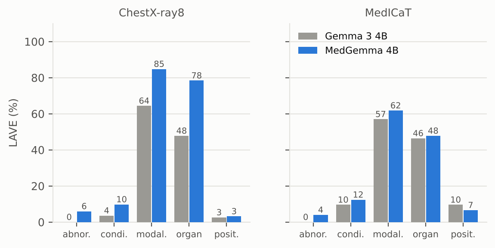

# Zero-shot VLM benchmark: BUS-BRA, RadImageNet-VQA, and BanglaMedVQA

We tested whether medical vision-language models (VLMs) perform better than their general-purpose versions on medical image tasks, without fine-tuning or examples in the prompt.

We compared two model pairs across three datasets.

| Pair | General model | Medical model |
|---|---|---|
| Qwen2-VL (~2B) | `Qwen/Qwen2-VL-2B-Instruct` | `JZPeterPan/MedVLM-R1` |
| Gemma 3 (~4B) | `google/gemma-3-4b-it` | `google/medgemma-4b-it` |

| Task | Dataset | What the model had to do | Sample |
|---|---|---|---|
| Classification | BUS-BRA (breast ultrasound) | Classify each lesion as benign or malignant | 400 images (200 each) |
| Visual QA | RadImageNet-VQA (CT, MRI, ultrasound) | Answer yes/no and multiple-choice questions | 500 questions |
| Visual QA in Bangla | BanglaMedVQA (chest X-rays and MedICaT images) | Answer open-ended questions written in Bangla | 500 questions |

## Key findings

- **BUS-BRA:** Three models mostly gave the same answer for every image. MedGemma did better at 57.5%, but still missed 118 of the 200 cancers.
- **RadImageNet-VQA:** All models scored 61–65% overall. The medical versions did not consistently beat their general-purpose counterparts.
- **Anatomy was easier than pathology.** Models often identified the body part, but struggled to identify what was wrong.
- **BanglaMedVQA:** MedGemma scored highest (31.5% LAVE), followed by Gemma 3 (24.1%), MedVLM-R1 (16.0%), and Qwen2-VL (15.1%). Most answers were in English, despite the questions being in Bangla.

## Results

### BUS-BRA

*400 images; chance level = 50%.*

| Model | Correct | Accuracy | Output pattern |
|---|---:|---:|---|
| Qwen2-VL-2B | 200 / 400 | 50.0% | Answered “benign” every time |
| MedVLM-R1 | 200 / 400 | 50.0% | Answered “benign” every time |
| Gemma 3 4B | 201 / 400 | 50.3% | “Malignant” 391 times, “benign” 9 times |
| **MedGemma 4B** | **230 / 400** | **57.5%** | “Benign” 266 times, “malignant” 134 times |

MedGemma detected 82 of 200 cancers (41% sensitivity) and correctly identified 148 of 200 benign cases (74% specificity). Its accuracy was above chance (95% CI: 52.6–62.3%; *p* = 0.0016). However, its difference from Gemma 3 was not statistically significant (McNemar *p* = 0.08), so we cannot attribute the result to medical pre-training alone. All model outputs were successfully parsed.

### RadImageNet-VQA

*500 questions; 100 in each group.*

| Question group | Chance | Qwen2-VL | MedVLM-R1 | Gemma 3 | MedGemma |
|---|---:|---:|---:|---:|---:|
| Anatomy, multiple choice | 25% | 87% | **88%** | 84% | 80% |
| Anatomy, yes/no | 50% | **88%** | 86% | 81% | 79% |
| Abnormality, yes/no | 50% | 55% | **61%** | 52% | 55% |
| Pathology, yes/no | 50% | 57% | 57% | **61%** | 60% |
| Pathology, multiple choice | 25% | **34%** | 33% | **37%** | 32% |
| **Overall** | **40%** | **64.2%** | **65.0%** | **63.0%** | **61.2%** |

The overall scores are close, so the small differences should not be treated as a reliable ranking. Each group has only 100 questions, which makes its score sensitive to a small number of answers.

Two patterns stood out:

- **Yes/no bias:** Although the sample was balanced, Gemma 3 answered “yes” in 74% of its yes/no responses (222/300), while MedGemma answered “no” in 58% (174/300). The Qwen models were more balanced, with “yes” answers around 53–54%.
- **Performance varied by body region:** Hip questions were the hardest for every model (37–53%). Results for individual regions should be treated cautiously because group sizes ranged from 26 to 163 questions.

### BanglaMedVQA

*500 open-ended questions in Bangla, covering abnormality, condition, modality, organ, and position across ChestX-ray8 and MedICaT images.*

We scored answers using exact match, BERTScore, and LAVE. LAVE uses GPT-4.1-mini to compare a model's answer with the reference answer; we use it as the main score.

| Model | Exact match | BERTScore | LAVE |
|---|---:|---:|---:|
| Qwen2-VL-2B | 0.0% | 68.6 | 15.1% |
| MedVLM-R1 | 0.0% | 68.4 | 16.0% |
| Gemma 3 4B | 2.4% | 69.0 | 24.1% |
| **MedGemma 4B** | 1.6% | **71.4** | **31.5%** |

Exact match is very low partly because of language differences. For example, a model might answer “X-ray” while the reference uses “এক্স-রে”. More than 80% of answers from every model contained no Bangla.

**LAVE by question type** (average across the two image sources):

| Question type | Qwen2-VL | MedVLM-R1 | Gemma 3 | MedGemma |
|---|---:|---:|---:|---:|
| Modality | 55.8 | 56.5 | 60.7 | **73.3** |
| Organ | 3.3 | 5.3 | 47.1 | **63.1** |
| Condition | 8.3 | 8.0 | 6.6 | **11.1** |
| Abnormality | 6.1 | **6.4** | 0.0 | 5.0 |
| Position | 2.2 | 3.7 | 6.1 | 4.9 |

**What stood out**

- **Modality was the easiest question type for every model.** Organ worked only for the Gemma models, and condition, abnormality and position stayed low for all four.
- **MedGemma performed best.** It scored 7.4 LAVE points above Gemma 3 (95% CI: 4.8–10.0), mainly on organ and modality questions.
- **MedVLM-R1 behaved almost like Qwen2-VL.** About 72% of their answers were identical, and MedVLM-R1 often fell back on one answer ("pneumonia" for 74% of chest X-ray condition questions).
- **Yes/no bias again.** On the abnormality questions, MedVLM-R1 never answered "Yes", while MedGemma mostly did.

**Limitations**

LAVE probably underestimates performance. The judge gave no credit to MedGemma's correct "Yes"/"No" answers because they were in English and the references were in Bangla. Also, we used 500 training-split questions, whereas the original paper used 400 test questions, so the results are not directly comparable.
 

## How we ran it

All models used the same samples, prompts, and generation settings. Only the model-loading code differed.

- **Prompts:** One fixed prompt per task, with no extra context. BUS-BRA requested `benign` or `malignant`; RadImageNet-VQA requested a letter or yes/no; BanglaMedVQA used the paper's short-answer prompt in Bangla.
- **Generation:** Greedy decoding, batch size 1, bf16, seed 42, and output limits of 16–96 tokens (256 for MedVLM-R1 on BanglaMedVQA).
- **Samples:** 400 BUS-BRA images (200 benign, 200 malignant); 500 RadImageNet-VQA questions (100 per group, with balanced yes/no groups); and 500 BanglaMedVQA train-split questions, with 25 yes and 25 no abnormality questions per image source.
- **LAVE judge:** GPT-4.1-mini, using the BanglaMedVQA paper's judge prompt.
- **Parsing:** Answers outside the expected format counted as incorrect. This did not happen in our runs.
- **Versions and hardware:** Qwen2-VL and MedVLM-R1 use pinned Hugging Face commits. BUS-BRA ran on Kaggle T4 GPUs.

## What we learned

1. **Zero-shot breast ultrasound classification was unreliable.** Three models mostly repeated one label. MedGemma performed better, but detected only 82 of 200 cancers.
2. **Medical models were not consistently better.** MedGemma led on BanglaMedVQA, but its BUS-BRA improvement over Gemma 3 was not statistically significant, and it had the lowest overall score on RadImageNet-VQA.
3. **Identifying anatomy was easier than identifying disease.** This pattern appeared in both visual QA datasets.
4. **Language affects the results.** Most BanglaMedVQA answers were in English, making it difficult to separate image-understanding errors from Bangla-language errors. Testing the same questions in English would help distinguish the two.
5. **Accuracy alone can hide failure modes.** A model can score 50% on a balanced dataset by always predicting one class. Looking at the actual answers revealed this.
