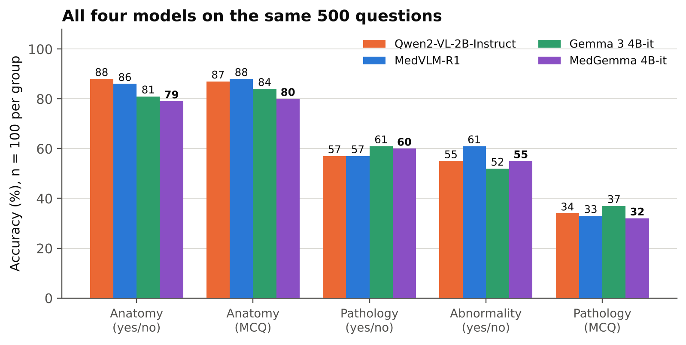
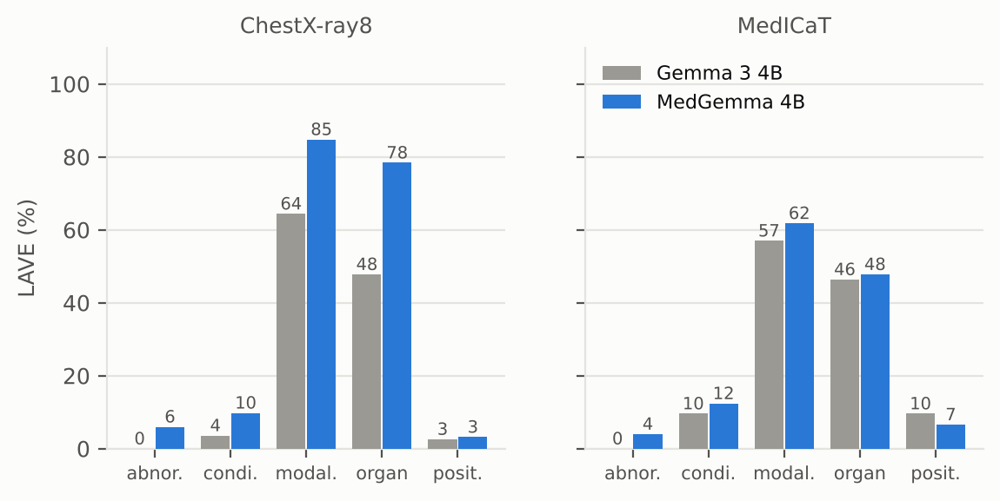

# Zero-shot VLM benchmark: BUS-BRA, RadImageNet-VQA, and BanglaMedVQA

We tested whether medical vision-language models (VLMs) perform better than their general-purpose versions on medical image tasks, without fine-tuning or examples in the prompt. As a control, we then repeated every task with the image replaced by a blank white image, to see how much each answer depends on the image (see [Blank-image control](#blank-image-control)).

We compared two model pairs across three datasets.

| Pair | General model | Medical model |
|---|---|---|
| Qwen2-VL (~2B) | `Qwen/Qwen2-VL-2B-Instruct` | `JZPeterPan/MedVLM-R1` |
| Gemma 3 (~4B) | `google/gemma-3-4b-it` | `google/medgemma-4b-it` |

| Task | Dataset | What the model had to do | Sample |
|---|---|---|---|
| Classification | BUS-BRA (breast ultrasound) | Classify each lesion as benign or malignant | 400 images (200 each) |
| Visual QA | RadImageNet-VQA (CT, MRI) | Answer yes/no and multiple-choice questions | 500 questions |
| Visual QA in Bangla | BanglaMedVQA (chest X-rays and MedICaT images) | Answer open-ended questions written in Bangla | 500 questions |

## Key findings

- **BUS-BRA:** Three models mostly gave the same answer for every image. MedGemma did better at 57.5%, but still missed 118 of the 200 cancers.
- **RadImageNet-VQA:** All models scored 61–65% overall. The medical versions did not consistently beat their general-purpose counterparts.
- **Anatomy was easier than pathology.** Models often identified the body part, but struggled to identify what was wrong.
- **BanglaMedVQA:** MedGemma scored highest (31.5% LAVE), followed by Gemma 3 (24.1%), MedVLM-R1 (16.0%), and Qwen2-VL (15.1%). Most answers were in English, despite the questions being in Bangla.
- **Blank-image control:** With a blank white image, RadImageNet-VQA accuracy fell to 38–44% (chance is 40%) and BanglaMedVQA LAVE fell to 2.6–11.7%. On BUS-BRA every model answered “benign” for all 400 cases. Anatomy and modality answers depend on the image, while disease answers were only slightly better with the real image.

## Results

### BUS-BRA

*400 images; chance level = 50%.*

| Model | Correct | Accuracy | Output pattern |
|---|---:|---:|---|
| Qwen2-VL-2B | 200 / 400 | 50.0% | Answered “benign” every time |
| MedVLM-R1 | 200 / 400 | 50.0% | Answered “benign” every time |
| Gemma 3 4B | 201 / 400 | 50.3% | “Malignant” 391 times, “benign” 9 times |
| **MedGemma 4B** | **230 / 400** | **57.5%** | “Benign” 266 times, “malignant” 134 times |

MedGemma detected 82 of 200 cancers (41% sensitivity) and correctly identified 148 of 200 benign cases (74% specificity). Its accuracy was above chance (95% CI: 52.6–62.3%; *p* = 0.0016). However, its difference from Gemma 3 was not statistically significant (McNemar *p* = 0.08), so we cannot attribute the result to medical pre-training alone. All model outputs were successfully parsed.

### RadImageNet-VQA

*500 questions; 100 in each group.*

| Question group | Chance | Qwen2-VL | MedVLM-R1 | Gemma 3 | MedGemma |
|---|---:|---:|---:|---:|---:|
| Anatomy, multiple choice | 25% | 87% | **88%** | 84% | 80% |
| Anatomy, yes/no | 50% | **88%** | 86% | 81% | 79% |
| Abnormality, yes/no | 50% | 55% | **61%** | 52% | 55% |
| Pathology, yes/no | 50% | 57% | 57% | **61%** | 60% |
| Pathology, multiple choice | 25% | **34%** | 33% | **37%** | 32% |
| **Overall** | **40%** | **64.2%** | **65.0%** | **63.0%** | **61.2%** |

The overall scores are close, so the small differences should not be treated as a reliable ranking. Each group has only 100 questions, which makes its score sensitive to a small number of answers.

Two patterns stood out:

- **Yes/no bias:** Although the sample was balanced, Gemma 3 answered “yes” in 74% of its yes/no responses (222/300), while MedGemma answered “no” in 58% (174/300). The Qwen models were more balanced, with “yes” answers around 53–54%.
- **Performance varied by body region:** Hip questions were the hardest for every model (37–53%). Results for individual regions should be treated cautiously because group sizes ranged from 26 to 163 questions.

### BanglaMedVQA

*500 open-ended questions in Bangla, covering abnormality, condition, modality, organ, and position across ChestX-ray8 and MedICaT images.*

We scored answers using exact match, BERTScore, and LAVE. LAVE uses GPT-4.1-mini to compare a model's answer with the reference answer; we use it as the main score.

| Model | Exact match | BERTScore | LAVE |
|---|---:|---:|---:|
| Qwen2-VL-2B | 0.0% | 68.6 | 15.1% |
| MedVLM-R1 | 0.0% | 68.4 | 16.0% |
| Gemma 3 4B | 2.4% | 69.0 | 24.1% |
| **MedGemma 4B** | 1.6% | **71.4** | **31.5%** |

Exact match is very low partly because of language differences. For example, a model might answer “X-ray” while the reference uses “এক্স-রে”. More than 80% of answers from every model contained no Bangla.

**LAVE by question type** (average across the two image sources):

| Question type | Qwen2-VL | MedVLM-R1 | Gemma 3 | MedGemma |
|---|---:|---:|---:|---:|
| Modality | 55.8 | 56.5 | 60.7 | **73.3** |
| Organ | 3.3 | 5.3 | 47.1 | **63.1** |
| Condition | 8.3 | 8.0 | 6.6 | **11.1** |
| Abnormality | 6.1 | **6.4** | 0.0 | 5.0 |
| Position | 2.2 | 3.7 | 6.1 | 4.9 |

**What stood out**

- **Modality was the easiest question type for every model.** Organ worked only for the Gemma models, and condition, abnormality and position stayed low for all four.
- **MedGemma performed best.** It scored 7.4 LAVE points above Gemma 3 (95% CI: 4.8–10.0), mainly on organ and modality questions.
- **MedVLM-R1 behaved almost like Qwen2-VL.** About 72% of their answers were identical, and MedVLM-R1 often fell back on one answer ("pneumonia" for 74% of chest X-ray condition questions).
- **Yes/no bias again.** On the abnormality questions, MedVLM-R1 never answered "Yes", while MedGemma mostly did.

**Limitations**

LAVE probably underestimates performance. The judge gave no credit to MedGemma's correct "Yes"/"No" answers because they were in English and the references were in Bangla. Also, we used 500 training-split questions, whereas the original paper used 400 test questions, so the results are not directly comparable.
 

## Blank-image control

To check how much each answer depends on the image, we repeated all three tasks with every image replaced by a solid 512×512 blank image. Items, prompts, decoding, parsing and scoring were unchanged. RadImageNet-VQA and BanglaMedVQA used a white image. BUS-BRA used both white and black, and the two gave identical results.

**Real image → blank image:**

| Model | BUS-BRA accuracy | RadImageNet-VQA accuracy | BanglaMedVQA LAVE |
|---|---:|---:|---:|
| Qwen2-VL-2B | 50.0% → 50.0% | 64.2% → 41.6% | 15.1% → 2.7% |
| MedVLM-R1 | 50.0% → 50.0% | 65.0% → 43.8% | 16.0% → 2.6% |
| Gemma 3 4B | 50.3% → 50.0% | 63.0% → 38.8% | 24.1% → 11.7% |
| MedGemma 4B | 57.5% → 50.0% | 61.2% → 38.4% | 31.5% → 7.2% |

Chance is 50% on BUS-BRA and 40% over the RadImageNet-VQA mix. Every RadImageNet-VQA and BanglaMedVQA drop is statistically significant (McNemar or paired permutation test, *p* < 0.001).

**RadImageNet-VQA accuracy by group (real → blank):**

| Question group | Chance | Qwen2-VL | MedVLM-R1 | Gemma 3 | MedGemma |
|---|---:|---:|---:|---:|---:|
| Anatomy, multiple choice | 25% | 87 → 28 | 88 → 36 | 84 → 11 | 80 → 15 |
| Anatomy, yes/no | 50% | 88 → 55 | 86 → 57 | 81 → 52 | 79 → 51 |
| Abnormality, yes/no | 50% | 55 → 50 | 61 → 50 | 52 → 54 | 55 → 50 |
| Pathology, yes/no | 50% | 57 → 51 | 57 → 51 | 61 → 53 | 60 → 51 |
| Pathology, multiple choice | 25% | 34 → 24 | 33 → 25 | 37 → 24 | 32 → 25 |

**What stood out**

- **Anatomy and modality depend on the image; disease barely does.** On RadImageNet-VQA the real image helped by 28–73 points on anatomy questions, but only by −2 to +13 points on abnormality and pathology questions.
- **The option-letter preference does not come from the image.** The most-chosen letter on pathology MCQ was the same with and without the image for all four models (C for the Qwen pair, B for the Gemma pair).
- **The yes/no and “malignant” preferences do.** The share of “yes” answers over the 300 yes/no questions fell from 54%, 53%, 74% and 42% to 12%, 13%, 30% and 14% (Qwen2-VL, MedVLM-R1, Gemma 3, MedGemma). Gemma 3 answered “malignant” for 391 real BUS-BRA images but “benign” for the blank one.
- **Qwen2-VL and MedVLM-R1 ignore the image on BUS-BRA.** Their answers with real images were identical to their blank-image answers on all 400 cases.
- **MedGemma uses the image more than Gemma 3 on BanglaMedVQA.** Its LAVE drop is 11.9 points larger (95% CI: 7.2–16.5), so its 7.4-point lead is not a language prior. MedVLM-R1 and Qwen2-VL differ by only 0.9 points.
- **Blank-image answers are nearly constant.** Gemma 3 answered “X-ray” to 94 of 100 modality questions, which is correct for 56% of references, so it kept a modality LAVE of 48.7. MedGemma answered “CT” to all 100 modality questions and “brain” to 98 of 100 organ questions. Qwen2-VL and MedVLM-R1 named no modality. Gemma 3 returned an empty answer for 125 of 500 blank-image questions.

**Caveats:** BUS-BRA blank-image scores are derived from five identical inferences per colour and model, copied to all 400 items, because the input is the same for every case. A blank image is an unnatural input, and we did not run a shuffled-image control (real images paired with the wrong questions).

Per-dataset summaries, figures, and reports are in each dataset's blank-control folder (see [Repository layout](#repository-layout)). The figures and reports there end in `_blank`.

## How we ran it

All models used the same samples, prompts, and generation settings. Only the model-loading code differed.

- **Prompts:** One fixed prompt per task, with no extra context. BUS-BRA requested `benign` or `malignant`; RadImageNet-VQA requested a letter or yes/no; BanglaMedVQA used the paper's short-answer prompt in Bangla.
- **Generation:** Greedy decoding, batch size 1, bf16, seed 42, and output limits of 16–96 tokens (256 for MedVLM-R1 on BanglaMedVQA).
- **Samples:** 400 BUS-BRA images (200 benign, 200 malignant); 500 RadImageNet-VQA questions (100 per group, with balanced yes/no groups); and 500 BanglaMedVQA train-split questions, with 25 yes and 25 no abnormality questions per image source.
- **LAVE judge:** GPT-4.1-mini, using the BanglaMedVQA paper's judge prompt.
- **Parsing:** Answers outside the expected format counted as incorrect. This did not happen in our runs.
- **Versions and hardware:** Qwen2-VL and MedVLM-R1 use pinned Hugging Face commits. BUS-BRA ran on Kaggle T4 GPUs; the logs are in [`logs/`](logs/).
- **Blank-image control:** The same notebooks with only the image replaced by a solid 512×512 image (`BLANK_COLOR` is `white` or `black`). For BUS-BRA we ran five identical inferences per colour and model, saw the same output every time, and assigned it to all 400 items.
- **Checking the numbers:** [`analysis/verify_numbers.js`](analysis/verify_numbers.js) recomputes the reported numbers from the saved result CSVs (Node.js, no dependencies).

## What we learned

1. **Zero-shot breast ultrasound classification was unreliable.** Three models mostly repeated one label. MedGemma performed better, but detected only 82 of 200 cancers.
2. **Medical models were not consistently better.** MedGemma led on BanglaMedVQA, but its BUS-BRA improvement over Gemma 3 was not statistically significant, and it had the lowest overall score on RadImageNet-VQA.
3. **Identifying anatomy was easier than identifying disease.** This pattern appeared in both visual QA datasets.
4. **Language affects the results.** Most BanglaMedVQA answers were in English, making it difficult to separate image-understanding errors from Bangla-language errors. Testing the same questions in English would help distinguish the two.
5. **Accuracy alone can hide failure modes.** A model can score 50% on a balanced dataset by always predicting one class. Looking at the actual answers revealed this.
6. **Blank-image controls show what the image contributes.** Anatomy and modality answers depend on the image, but disease answers were only slightly better with the real image. Some preferences (option letters) persist without the image, while others (“yes”, “malignant”) appear only when a scan is shown.

## Repository layout

| Folder | Contents |
|---|---|
| `BUS_BRA/` | Notebooks, `Results/Final/` (per-model results, figures, reports), `Results/Blank Control/` (white and black controls), `blank control/` (blank-control notebooks and `summary.md`) |
| `RadImageNet_VQA/` | One folder per model (`GEMMA 3`, `MEDGEMMA`, `MEDVLM`, `QWEN`) with notebook, results, figures and report; `Blank_Control/` (per-model blank-control results, `_blank` figures and reports, cross-model comparison, `summary.md`); `analysis/` (unique-image audit) |
| `BanglaMedVQA/` | One folder per model (`Gemma`, `Medgemma`, `MEDVLM`, `QWEN`) with notebook, results, figures and report; `Blank_Control/` (same structure as above) |
| `analysis/` | Scripts that recompute the reported numbers from the result CSVs |
| `logs/` | Kaggle run logs for the BUS-BRA runs, including the blank controls |
| `paper_v2/` | Revision drafts of the paper (the blank-image control insertions) |
