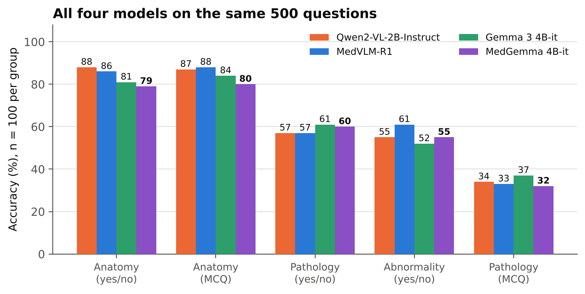

# Zero-shot VLM benchmark on BUS-BRA and RadImageNet-VQA

We wanted to know whether a medical vision-language model (VLM) actually beats its general-purpose parent when you ask both the same questions about medical images, with no fine-tuning and no examples in the prompt.

We tested two model pairs on two tasks.

| Pair           | General model               | Medical version of it   |
| -------------- | --------------------------- | ----------------------- |
| Qwen2-VL (~2B) | `Qwen/Qwen2-VL-2B-Instruct` | `JZPeterPan/MedVLM-R1`  |
| Gemma 3 (~4B)  | `google/gemma-3-4b-it`      | `google/medgemma-4b-it` |

| Task           | Dataset                             | What the model has to do                      | Sample                 |
| -------------- | ----------------------------------- | --------------------------------------------- | ---------------------- |
| Classification | BUS-BRA (breast ultrasound)         | Say whether the lesion is benign or malignant | 400 images (200 + 200) |
| Visual QA      | RadImageNet-VQA (CT/MRI/ultrasound) | Answer yes/no and multiple-choice questions   | 500 questions          |

## The short version

- **BUS-BRA: three of the four models effectively did not do the task.** Qwen2-VL and MedVLM-R1 answered "benign" for every single image, and Gemma 3 answered "malignant" for 391 of 400. Each lands on about 50%, which is exactly chance on a balanced set. Only MedGemma gave answers that carry some signal (57.5%), and even that misses about 59% of the cancers.
- **RadImageNet-VQA: all four models are clearly above chance but close to each other** (61–65% overall). The medical models are *not* better than the general ones here. The medical variant won in one pair and lost in the other, by margins that are small for 500 questions.
- Questions about **anatomy** are easy (80–88% on multiple choice). Questions about **pathology** are hard (32–37% on multiple choice, against a 25% chance level). The models can see which body part it is, but they can't reliably tell what is wrong with it.

## Results

### BUS-BRA (400 images, chance = 50%)

| Model           | Correct       | Accuracy  | What it actually did                      |
| --------------- | ------------- | --------- | ----------------------------------------- |
| Qwen2-VL-2B     | 200 / 400     | 50.0%     | "benign" every time                       |
| MedVLM-R1       | 200 / 400     | 50.0%     | "benign" every time                       |
| Gemma 3 4B      | 201 / 400     | 50.3%     | "malignant" 391 times, "benign" 9 times   |
| **MedGemma 4B** | **230 / 400** | **57.5%** | "benign" 266 times, "malignant" 134 times |

MedGemma found 82 of 200 cancers (41% sensitivity) and 148 of 200 benign cases (74% specificity). The per-model Word reports give the 95% confidence interval for this (52.6–62.3%) and a significance test against chance (p = 0.0016). The gap between MedGemma and Gemma 3 is not significant (McNemar p = 0.08), so we can't claim that medical pre-training is what helped. No answers were unparsed for any model.

### RadImageNet-VQA (500 questions, 100 per group)

| Group                      | Chance | Qwen2-VL | MedVLM-R1 | Gemma 3 | MedGemma |
| -------------------------- | ------ | -------- | --------- | ------- | -------- |
| Anatomy, multiple choice   | 25%    | 87       | **88**    | 84      | 80       |
| Anatomy, yes/no            | 50%    | **88**   | 86        | 81      | 79       |
| Abnormality, yes/no        | 50%    | 55       | **61**    | 52      | 55       |
| Pathology, yes/no          | 50%    | 57       | 57        | **61**  | 60       |
| Pathology, multiple choice | 25%    | **34**   | 33        | **37**  | 32       |
| **Overall**                | 40%    | 64.2     | **65.0**  | 63.0    | 61.2     |

Every group has only 100 questions, so a single cell is good for roughly ±10 points. Treat differences of a few points as noise. The overall ranking should not be read as "MedVLM-R1 is best".

Two other things stood out:

- **Yes/no bias.** The sample is exactly 50/50 yes/no, but Gemma 3 said "yes" 74% of the time (222 of 300) and MedGemma said "no" 58% of the time (174 of 300). The Qwen pair was closer to balanced (about 53–54% "yes").
- **Body region matters.** Hip was the weakest region for every model (37–53%). The best regions varied by model (brain, ankle/foot, shoulder, knee), and each region has only 26–163 questions, so we wouldn't read much into it.

<!-- ## How we ran it

Everything is the same across the four models except the code that loads the model.

- **Prompts.** One fixed prompt per task, with no reasoning or extra context. BUS-BRA asks for exactly `benign` or `malignant`; VQA asks for only a letter (multiple choice) or only Yes/No. Models only see the image and the prompt, never labels or metadata.
- **Decoding.** Greedy (`do_sample=False`), batch size 1, bf16, SDPA attention, `max_new_tokens` = 32 (BUS-BRA) and 16 (VQA), seed 42.
- **Sampling.** Seed 42, so every model sees the same items.
  - BUS-BRA: 200 benign + 200 malignant, one image per source `Case` so that no patient (as far as the dataset's `Case` field tells us) appears twice. We excluded the images used in the pilot and 13 cases flagged during our data audit. A SHA-256 hash of the sample is checked in the notebooks.
  - RadImageNet-VQA: only the closed (yes/no) and multiple-choice questions, in five groups of 100. Each yes/no group is 50 yes and 50 no. Open-ended questions are left out.
- **Parsing.** Strict. If the output isn't a clear label, letter or yes/no, it counts as `unparsed` and as wrong. In practice there were none.
- **Model versions.** Qwen2-VL and MedVLM-R1 are pinned to exact Hugging Face commits. BUS-BRA runs used `transformers` 4.57.1 on Kaggle T4 x2 GPUs, where bf16 is emulated rather than native.

## What we take from this

1. **Zero-shot, small VLMs are not usable for breast-ultrasound diagnosis.** The best result (MedGemma, 57.5%) is statistically above chance but clinically meaningless. The two Qwen models and Gemma 3 never really looked at the lesion: they fell back on a single answer. Accuracy alone would have hidden this, which is why we looked at per-class recall and the raw outputs.
2. **"Medical" did not mean "better".** In the Gemma pair, medical training moved BUS-BRA from a degenerate "always malignant" to a skewed but informative "mostly benign", yet on VQA MedGemma was the lowest of the four. In the Qwen pair, MedVLM-R1 behaved identically to its base model on BUS-BRA and was within noise on VQA. We could not show a consistent benefit of medical adaptation at this scale.
3. **The models recognise anatomy, not disease.** Anatomy questions reached 80–88% on multiple choice, while pathology multiple choice stayed at 32–37% (chance is 25%). They can tell *where* something is, but not reliably *what* is wrong with it.
4. **Each model has a built-in bias that dominates its score.** Always-benign, always-malignant, yes-heavy and no-heavy answer habits show up across the study. A model's accuracy on a balanced benchmark mostly reflects how far it escapes that habit.
5. **Small differences are not findings.** With 400 and 500 questions, gaps of a few points between models should not be treated as a ranking. -->

## How we ran it

All four models were evaluated using the same prompts, samples, and inference settings. The only difference was how each model was loaded.

- **Prompts:** We used fixed prompts with no extra context or reasoning. BUS-BRA required a `benign` or `malignant` answer, while VQA required only an option letter or Yes/No. Models received the image and prompt, without labels or metadata.
- **Decoding:** Greedy decoding (`do_sample=False`), batch size 1, bf16, SDPA attention, `max_new_tokens` of 32 for BUS-BRA and 16 for VQA, with seed 42.
- **Sampling:** All models were tested on the same samples.
  - BUS-BRA: 400 images (200 benign, 200 malignant), with one image per source `Case`. Pilot images and 13 cases flagged during our data audit were excluded.
  - RadImageNet-VQA: 500 questions across five groups, with 100 per group. Yes/no groups were balanced; open-ended questions were excluded.
- **Parsing:** Responses that did not match the expected answer format counted as incorrect. All model outputs were successfully parsed.
- **Model versions:** Qwen2-VL and MedVLM-R1 were pinned to specific Hugging Face commits. BUS-BRA runs used `transformers` 4.57.1 on Kaggle T4 GPUs, where bf16 is emulated rather than natively supported.

Each model has its own notebook, following the same workflow: load the data and model, run inference, save predictions, and calculate metrics. We also save the raw outputs, making it possible to inspect mistakes and re-evaluate predictions without running inference again.

## What we take from this

1. **Zero-shot breast ultrasound classification remains a major challenge.** Qwen2-VL and MedVLM-R1 predicted `benign` for every image, while Gemma 3 predicted `malignant` for 391 out of 400 images. MedGemma performed better at 57.5%, but detected only 82 of 200 malignant cases. These results are not reliable enough for diagnosis.

2. **Medical models were not consistently better.** MedGemma outperformed Gemma 3 on BUS-BRA, but the difference was not statistically significant. On VQA, MedGemma scored lowest among the four models, while MedVLM-R1 remained close to its base model. We found no consistent benefit from medical adaptation.

3. **Anatomy was easier than pathology.** On VQA, anatomy multiple-choice accuracy reached 80–88%, while pathology multiple-choice accuracy was only 32–37% (25% by random guessing). The models were better at identifying anatomical structures than recognising diseases.

4. **Accuracy alone can be misleading.** A model that always predicts one class can still score 50% on a balanced dataset. We also observed yes/no biases in VQA. Looking at answer distributions and per-class metrics was therefore important for understanding the actual results.

5. **Small differences should not be overinterpreted.** Each VQA question group contains only 100 questions, so differences of a few percentage points may not indicate a real performance gap. The overall scores do not establish a definitive ranking between models.